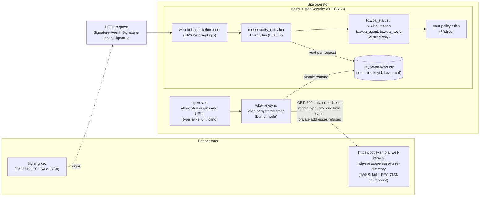
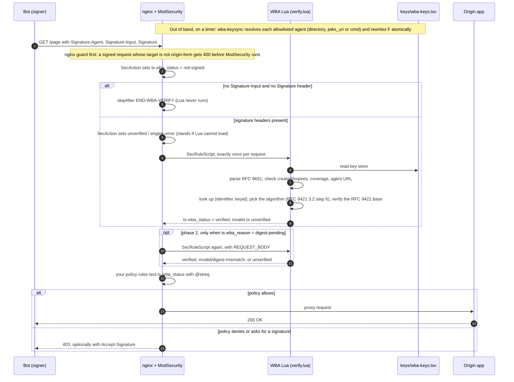

# Web Bot Auth for ModSecurity: how it works

The [README](README.md) says how to set the plugin up and use it. This file says what it does and why, in detail: what `verified` means, how bodies, algorithms and agent URLs are checked, how keys reach the verifier, and the engine facts the design rests on. [TESTING.md](TESTING.md) says what is proven and how; [CONFORMANCE.md](CONFORMANCE.md) traces every sentence of the standards.

## What `verified` means

Exactly this, and nothing weaker:

- The request's `Host` is one of your site names (`tx.wba_site_names`); any other is `invalid/foreign-authority`, and until the names are set nothing verifies (`unverified/no-site-names`).
- A signature tagged `web-bot-auth` carries `created` and `expires`. Its `created` is at most 60 s ahead of this clock (`not-yet-valid`); it has not expired, strictly, unless `tx.wba_expiry_grace` allows up to 60 s more (`expired`); it was created at most `tx.wba_max_age` seconds ago, an hour by default (RFC 9421 3.2.1, `too-old`); and its window (`expires` minus `created`) is no longer than `tx.wba_max_window` if you set one (`window-too-long`). With the maximum age on, there is no window cap by default: the age already bounds how long a signature counts, and draft 5.2's 24 hours is RECOMMENDED for signers. With `tx.wba_max_age=0`, the cap is a day.
- It covers `@authority` (or `@target-uri`) and the `Signature-Agent` member it is attributed to (draft 5.2.1). If it covers one member, that one. If it covers several (draft Appendix D.2: an outer signer also covers an inner signer's member), the one keyed to its own label; if none is, `invalid/ambiguous-agent`.
- That member is an `https` URL of a type this verifier supports (draft 5.5): `directory` (the default), an origin whose key directory, `https://<origin>/.well-known/http-message-signatures-directory`, is the identifier; or `jwks_uri` / `cimd`, whose own URL, query and fragment dropped, is the identifier. That identifier is on your allowlist and was resolved by `wba-keysync`.
- The key store holds a current key for exactly that (identifier, keyid) pair. A key never counts for another agent (draft 5.4).
- The signature's algorithm is the one RFC 9421 3.2 step 6 determines from the key and the `alg` parameter (they must agree), and it verifies the RFC 9421 signature base rebuilt from this request's raw bytes ([Algorithms](#algorithms)).
- If it covers `Content-Digest`, `Repr-Digest` or `Unencoded-Digest`, the body matches that digest (RFC 9421 7.2.8, RFC 9530); for `Unencoded-Digest`, once its content codings are removed. See [Body digests](#body-digests).
- It meets your own settings: the minimum coverage (`tx.wba_require_components`) and a nonce (`tx.wba_require_nonce`) where you require them, and with replay accounting on, its use was counted (`unverified/replay-unavailable` otherwise).

A request with no `Signature-Agent` header is the one exception to the agent bullets: a held key verifies it as `verified/url-less`, attributed to the key alone (see "`Signature-Agent` members" under [Algorithms](#algorithms)).

A verified signature proves who signed, not that they are benign or authorised (draft 4.1). It is an input to your policy, not a policy.

### Body digests

A signature binds the body only through a digest field it covers. RFC 9421 7.2.8 says the verifier must then check that digest against the content received, and the body arrives after the headers:

- **Phase 1** (headers): a good signature that covers a digest is `unverified/digest-pending`, never `verified`.
- **Phase 2** (body read): a second rule re-runs the whole verification with `REQUEST_BODY`, at phase 1's time, and decides. A match is `verified`. A mismatch, an added body or a removed body is `invalid/digest-mismatch`.
- If phase 2 never runs (request body access off for that transaction), the request stays `unverified/digest-pending`. libmodsecurity skips every phase-2 rule when it has not read the body, so a body-bound signature is never verified without its body.

What is checked:

- **Only covered members count.** A bare, `;sf` or `;bs` component covers the whole field; `;key="sha-256"` covers that one member. A member the signature does not cover can be added by anyone on the path, so it is never read.
- **Only Active algorithms** (RFC 9530 5; IANA: `sha-256`, `sha-512`). Deprecated ones (`md5`, `sha`, `unixsum`, `unixcksum`, `adler`, `crc32c`) MUST NOT be used where an attacker may be present; with no Active covered member the result is `unverified/digest-algorithm-unsupported`.
- **The strongest covered algorithm decides** (`sha-512`, then `sha-256`). Skipping the weaker cannot be exploited (RFC 9530 6.6, 6.7): a forger would need a SHA-512 collision.
- **What each field is compared with.**
  - **Content-Digest** (RFC 9530 2): the body as received.
  - **Repr-Digest** (RFC 9530 3): the body as received too. A representation is defined in its coded form (RFC 9110 8.4), so a gzip body's Repr-Digest is over the gzip bytes, and nothing is decoded for it.
  - **Unencoded-Digest** ([draft-ietf-httpbis-unencoded-digest-05](https://datatracker.ietf.org/doc/draft-ietf-httpbis-unencoded-digest/) 3, 5): the body with its content codings removed, last applied first (`Content-Encoding: deflate, gzip` removes gzip, then deflate). Decoded here: `gzip` (and `x-gzip`, RFC 9110 8.4.1.3) and `deflate`, which is the zlib format (8.4.1.2), not raw deflate; `identity` is no coding. Any other coding (`br`, `zstd`, `compress`, `aes128gcm`, an unknown one) is `unverified/digest-coding-unsupported`, decided in phase 1 ([Not implemented](#not-implemented) says why). A body that is not valid data in its declared coding is `invalid/bad-content-coding`: truncated, a failed CRC-32, ISIZE or Adler-32, bytes after the last gzip member or after the zlib stream, a zlib preset dictionary (RFC 1950 2.3: HTTP defines none, so it must not be set), or the wrong coding.
- **Partial content.** `Content-Range` in a request means something only on PUT (RFC 9110 14.5, partial PUT); on any other method a server "MUST ignore" it (14.4), and so does this: the body is the whole representation. On a PUT, Repr-Digest and Unencoded-Digest are checked only when the range is the whole representation, `bytes 0-(n-1)/n` with n bytes of content. Any other range, an unknown length (`*`), another unit or an unparsable value is `unverified/digest-partial`. Content-Digest is over the content, so it is checked either way.
- **The received bytes first.** Content-Digest and Repr-Digest are compared before anything is decoded, so a body that fails them never reaches the decoder (the mitigation the unencoded-digest draft gives in its section 7).
- **Incomplete bodies are never compared.** `INBOUND_DATA_ERROR=1` (the body was cut at `SecRequestBodyLimit`, or a form/JSON/XML body exceeded `SecRequestBodyNoFilesLimit`) gives `unverified/body-incomplete`, so a signed prefix can never verify.
- **Cost:** SHA-512 runs in C (OpenSSL, through lua-openssl: 0.76 ms per MiB in the CRS image). SHA-256 runs in Lua (about 4.2 MB/s on the image's Lua 5.3), so a body over `max_sha256_body` (default 128 KiB, about 31 ms) is not hashed with it: `unverified/body-too-large` (RFC 9530 6.7). For Unencoded-Digest that limit applies to the decoded body. Each algorithm runs at most once per request on each input. Only a good signature from a key in your store gets a body hashed or decoded.
- **Decoding is bounded.** It runs in Lua ([`coding.lua`](coding.lua)), at 3.2 MB/s on the image's Lua 5.3 in the worst case a sender can construct (every literal on a 15-bit code, plus the gzip CRC), and at 9.5 MB/s on typical data (the gzip CLI's output for JSON-like text, CRC included), so 128 KiB of it takes about 14 ms. It stops at `min(max_decoded_body, max_decode_ratio × body length)` units, giving `unverified/body-too-large`: each decoded byte is a unit, every deflate block costs 16 more (a dynamic one 1024, for its Huffman tables), and a gzip header under FHCRC costs its length, so floods of empty blocks or a giant header are bounded like output. Defaults: 128 KiB, about 40 ms at the worst case (the SHA-256 cap's order), and a ratio of 200, Apache httpd's default `DeflateInflateRatioLimit`. A 10 MiB gzip bomb (about 10 KB on the wire), the same bomb gzipped again, and floods of empty blocks all stop there. The body is decoded at most once per request.

Bot operators: prefer `sha-512` for bodies larger than 128 KiB, and cover `Content-Digest` (the bytes you send) unless the site asks for Unencoded-Digest.

**Unencoded-Digest vouches for the decoded representation, not for the bytes.** One representation has many gzip encodings, and gzip carries free-form header fields (FNAME, FCOMMENT, FEXTRA) and may be split into several members (RFC 1952 2.2), all of which decode to the same bytes. So whoever holds a signature that covers Unencoded-Digest but not Content-Digest can replay it with a re-encoded body. That is harmless only if your application decodes `Content-Encoding` as RFC 1952 and RFC 1950 define it. An application that reads the raw body, or a decoder that stops at the end of the first gzip member (zlib's `inflate()` does, unless called again), can be handed a body the signer never signed: a prefix of it, or bytes hidden in a gzip header. If yours might, require the raw bytes to be signed too: `tx.wba_require_components=content-digest` ([Controls and defaults](README.md#controls-and-defaults)). Covering `Content-Encoding` as well is RFC 9530 6.3's advice.

**In the CRS image, content-coded JSON is refused before this runs.** Rule 200001 in the image's `modsecurity.conf` turns on the JSON body processor for `Content-Type: application/json`. ModSecurity does not remove `Content-Encoding` first, so the processor fails on a gzip body and rule 200002 answers 400 in phase 2, before this plugin's phase-2 rule. A coded body whose type has no body processor (`application/octet-stream`, for one) reaches it. This is read from the image's `modsecurity.conf.template`; it is not a live case.

### Algorithms

The algorithms are RFC 9421 3.3's, less `hmac-sha256` (draft 6.4: "Implementations MUST NOT use shared HMAC"). Each is implemented exactly as its section says, through OpenSSL ([Crypto dependency](#crypto-dependency)):

| `alg` | Key (JWK) | RFC 9421 | Signature |
|---|---|---|---|
| `ed25519` | OKP, Ed25519 | 3.3.6 | 64 bytes; pure Ed25519, no prehash |
| `ecdsa-p256-sha256` | EC, P-256 | 3.3.4 | r ‖ s, 32 bytes each: 64 bytes, never DER |
| `ecdsa-p384-sha384` | EC, P-384 | 3.3.5 | r ‖ s, 48 bytes each: 96 bytes, never DER |
| `rsa-pss-sha512` | RSA | 3.3.1 | modulus length; SHA-512, MGF1 with SHA-512, salt length exactly 64 |
| `rsa-v1_5-sha256` | RSA | 3.3.2 | modulus length; PKCS #1 v1.5 with SHA-256 |

**Which algorithm** (RFC 9421 3.2 step 6, in order):

- An `alg` parameter naming anything else, `hmac-sha256` included, is `invalid/unsupported-alg` (step 6.1).
- The key gives one if its JWK carries `alg` (key-sync stores it), or if its type allows only one: Ed25519, P-256 and P-384 keys do (step 6.3). An RSA key allows two, so its type alone gives none.
- The signature's `alg` parameter gives one (step 6.4).
- Where both give one, they must be the same, or the result is `invalid/alg-mismatch` (step 6.5). An `alg` for another key type is `invalid/alg-mismatch` too (step 8: the key material must be appropriate). So a key whose directory pins it to `rsa-pss-sha512` never verifies a PKCS #1 v1.5 signature (7.3.6).
- Neither: `invalid/alg-undetermined`. Only an RSA key without a JWK `alg`, under a signature without `alg`, gets here; the verifier never guesses.
- A signature of any other length than the table's is `invalid/bad-signature` and never reaches the crypto. A DER-encoded ECDSA signature is the wrong length, so it is refused.
- URL-less (no `Signature-Agent`, draft 4.3): every directory that lists the key must allow the same algorithm, so one directory's pin is never bypassed through another.

**Keys** (key-sync and the store enforce both; RFC 9421 3.2.1 makes key size an application requirement): an RSA modulus of 2048 to 16384 bits, odd, with a public exponent that is odd, at least 3 and below 2^256; above 3072 bits, the exponent must be at most 64 bits, because OpenSSL verifies nothing with a wider one there (`OPENSSL_RSA_SMALL_MODULUS_BITS` 3072, `OPENSSL_RSA_MAX_PUBEXP_BITS` 64), so such a key could never verify a request. The floor is [RFC 7518](https://www.rfc-editor.org/rfc/rfc7518) 3.3 and 3.5's "A key of size 2048 bits or larger MUST be used" for RS256 and PS512, the JOSE twins of `rsa-v1_5-sha256` and `rsa-pss-sha512`. The ceiling is OpenSSL's own. The exponent rules are RFC 8017 3.1's (3 ≤ e, e odd) plus FIPS 186-5's upper bound, because verification cost grows with e and any client can make the verifier pay it by naming a held keyid. EC coordinates are full size (RFC 7518 6.2.1.2) and the point must be on its curve.

**Cost of one verification** (`crypto.lua` end to end, in the pinned CRS image's test stage, OpenSSL 3.5.7, arm64 under Finch):

| Ed25519 | P-256 | P-384 | RSA 2048 | RSA 4096 | RSA 8192 | RSA 16384 |
|---|---|---|---|---|---|---|
| 0.096 ms | 0.080 ms | 0.47 ms | 0.04 ms | 0.10 ms | 0.30 to 0.42 ms | 1.1 ms |

Loading lua-openssl into the fresh Lua state libmodsecurity builds per run costs another 0.49 ms per signed request (luamonocypher cost 0.08 ms). Unsigned requests never run the Lua.

**Supported covered components** (RFC 9421 sections 2.1 and 2.2, each checked against the RFC's own examples):

- Derived: `@method`, `@authority`, `@scheme`, `@path`, `@query`, `@query-param;name="..."`, `@target-uri`, `@request-target`. `@scheme` and `@target-uri` use the scheme configured in `modsecurity_entry.lua` (`https`), because ModSecurity gives Lua no scheme; it is the connection's scheme for every request that gets verified, because the nginx guard refuses signed requests that did not arrive over TLS (draft 6.1, below).
- Any lowercase header field, all instances trimmed, unfolded and combined per 2.1, optionally with:
  - `;key="..."`, one Dictionary member (2.1.2); refused on a field the IANA registry types as a List or Item;
  - `;sf`, strict re-serialization (2.1.1), for fields whose Structured Field type is known: the IANA field registry's types, plus `Signature-Agent` and `Accept-Signature`;
  - `;bs`, each instance wrapped as a Byte Sequence (2.1.3).

These are refused as `invalid/unsupported-component`, because RFC 9421 2.5 requires an error when a component cannot be resolved: `@status` and `;req` (responses only), `;tr` (trailers never reach ModSecurity's request phase), `;sf` on a field of unknown type, `;bs` combined with `;sf` or `;key`, and unregistered names.

`@query-param` decodes the query with the URL Standard's form parser and re-encodes it with the form percent-encode set, as 2.2.8 says. Spaces become `+`, as 2.2.8's steps give them (the URL Standard's serializer, 5.2, with spaceAsPlus). The RFC's own example prints `%20` instead (`"@query-param";name="bar": with%20plus%20whitespace`). Both spell the same decoded parameters, so both verify: a name spelled with `%20` is the same name, and if the `+` base fails while a covered `@query-param` value has a space, the `%20` spelling is tried once, at most once per request and only for a key you hold ([CONFORMANCE.md](CONFORMANCE.md), choice 9). The generated vectors are `URLSearchParams` output, unchanged. A parameter name that appears more than once cannot be signed (2.2.8) and gives `invalid/missing-component`.

`Signature-Agent` members:

- An origin, `jwks_uri` or `cimd` URL with a scheme other than `https` (`http://bot.example`, say) is `invalid/agent-not-https` (draft 5.2.1: the scheme MUST be https). A `directory` member that is not an origin is ignored whatever its scheme (below).
- The `type` parameter (a Token, draft 5.2.1) picks the mechanism: absent or `directory`, `jwks_uri`, `cimd`. Any other type, or a type sent as a String, is ignored, as 5.2.1 requires: `unverified/unsupported-agent-type`. The mechanism is never inferred from the URL.
- `directory`: a value that is not the exact ASCII serialization of an origin (a path, a mixed-case host) is ignored, as draft 5.5 requires, whatever its scheme, which leaves the request `unverified/bad-agent-url`. An explicit default port (`https://agent.example:443`) is not the origin's ASCII serialization (RFC 6454 6.2), so it is ignored too; an empty path `/` is accepted, as 5.5 allows.
- `jwks_uri` and `cimd`: the identifier is the member value with its query and fragment dropped, compared after RFC 3986 6.2.2 and 6.2.3 normalization (lowercase scheme and host, percent-encoding normalized, dot segments removed, default port dropped), so every spelling of one URL is one identifier. A value that is not a URI, carries userinfo (RFC 9110 4.2.4), or names a port with a leading zero is ignored: `unverified/bad-agent-url`. Lookup is keyed on (identifier, keyid) whatever the type: a `jwks_uri` member naming a listed directory's well-known URI is that directory.
- IPv6 literal hosts (`https://[2001:db8::1]:8443`) work in every type. The identifier holds the address in RFC 5952 canonical text, so `[2001:0db8:0:0::1]` and `[2001:db8::1]` are one identifier; an origin with uppercase hex, a zone identifier or an IPvFuture literal is ignored.
- No `Signature-Agent` header at all: draft 4.3 makes the keyid thumbprint the identifier. A held key (under any identifier in the store) verifies the request as `verified/url-less`, attributed to the key alone; a key not held is `unverified/agent-absent`. A header that is present but whose member the signature does not cover is `invalid/agent-not-covered` (5.2.1).

## Several signatures on one request

When a request carries several `web-bot-auth` signatures, every one is validated, each against its own components and key (draft 5.2.2). The request gets the best outcome, ranked `verified` for a directory > `verified/url-less` > `digest-pending` > `invalid` > `unverified`: a pending signature can still verify in phase 2. `tx.wba_agent` is the first directory verified in Signature-Input order, and `tx.wba_agents` lists them all. Work that does not grow with the signatures is done once per request: each covered value is checked once, not once per signature; a lookup with no URL finds its line without copying the store; from a request's second key lookup on, one pass indexes the store; and the `%20` retry for `@query-param` runs at most once. Measured on the host with the crypto stubbed, in about 35 KiB of headers (nginx's default limit), before the crypto runs: 150 small signatures cost 9 to 10 ms; 55 signatures, each covering one 16 KiB field three ways, 10.7 ms (41 ms before); 150 URL-less signatures naming different keys, 11 ms with a 1,000-key store and 16.5 ms with 3,000 keys (57 and 163 ms before); a request that combines these, 13 ms. `Signature-Agent` is parsed once per request, however many signatures name it: when each signature parsed it again, 150 signatures over a 3.6 KiB field cost 113 ms on host Lua, now 9.5 ms (independent review; a unit test counts the parses). There is no cap by default, because draft 5.2.2 says verifiers MUST validate each signature; `policy.max_signatures` (in `modsecurity_entry.lua`'s `CONFIG.policy`) sets one, and a request over it is `unverified/too-many-signatures`. The crypto adds 150 verifications ([Algorithms](#algorithms)), at most 165 ms when every signature names a held 16384-bit RSA key, the largest key-sync accepts; about 14 ms for Ed25519 keys.

A label present in only one of `Signature-Input` and `Signature` is `invalid/orphan-label` (RFC 9421 4: "an error"), for any label, Web Bot Auth or not. RFC 9651 4.2 lets a field that is not a valid Structured Field be ignored, or the message be treated as malformed. `tx.wba_malformed` picks the branch for `Signature-Input`, `Signature` and `Signature-Agent`. By default (`ignore`) an unparsable `Signature-Input` or `Signature` is absent, so the request is `not-signed/unparsable-field`, and an unparsable `Signature-Agent` is `invalid/unparsable-agent`; with `reject` each is `invalid/malformed-headers`, and rule 9534107 answers 400 (draft 5.4 allows the 400). A body digest field the signature covers always takes the malformed branch: `invalid/malformed-digest`, and 400 from rule 9534107. Only a good signature from a key you list reaches that check, and ignoring the field would leave the body unchecked while the signature says it is bound to it.

## How it fits together



Keys are fetched **out of band**, never on the request path. ModSecurity makes no network calls, and a request's `Signature-Agent` header can never steer a fetch: only URLs you list are fetched, and a CIMD's `jwks_uri` hop only from a document at a URL you listed. Their DNS is still someone else's, so before every fetch, the hop included, key-sync refuses a host that is, or resolves to, a private, loopback or link-local address (draft 6.7); an IP literal is checked as written and never sent to DNS. It checks the resolution it is given; a name that changes its answer between that check and the fetch (DNS rebinding) is not caught, and TLS certificate validation is what stops that reaching an internal service.

## One request



## The nginx guard

**The nginx guard is part of the security boundary.** For an absolute-form request line (`GET http://other.example/ HTTP/1.1`), nginx routes by the request-line host but hands ModSecurity only the path. libmodsecurity then reads the `Host` header the client chose, so no ModSecurity variable ever holds the host nginx actually served.

Without the guard, a signature bound to `@authority: example.com` verified a request nginx served as `other.example`; this was reproduced live.

[`nginx/web-bot-auth-guard.conf`](nginx/web-bot-auth-guard.conf) (http context) and [`nginx/web-bot-auth-guard-server.conf`](nginx/web-bot-auth-guard-server.conf) (every `server` block) refuse, with 400, every *signed* request whose target is not origin-form (`/...`), and every *signed* request that did not arrive over TLS (draft 6.1: an origin SHOULD refuse Signature headers on an unsecured channel; over cleartext anyone on the path can change what a signature does not cover). Unsigned requests are untouched. If you run your own nginx instead of this image, include both files, and [`nginx/web-bot-auth-accept-signature.conf`](nginx/web-bot-auth-accept-signature.conf) in every `server` block if you use recipes A, D or E.

Behind a TLS-terminating load balancer nginx sees plain HTTP, so every signed request would get 400. Replace the guard's `$wba_tls` map with one built from a header that balancer always sets and clients cannot pass through (the file shows how). Never build it from a header a client can set.

This is one of the project's two deviations from a standard (see [Standards conformance](CONFORMANCE.md#summary-by-standard); the other is the 2 s clock allowance for a directory's [possession proof](#possession-proofs)): RFC 9112 3.2.2 says a server MUST accept absolute-form and use its authority. A compliant alternative, rewriting `Host` to the request-line authority with headers-more before ModSecurity reads it, was built and tested live, and it does not work with ModSecurity-nginx v1.0.4, the connector every official CRS image ships: v1.0.4 reads request headers before headers-more can change them, in either module order. The connector's unreleased `master` moves that work to nginx's access phase, which would make the compliant design possible.

The guard matches "not origin-form" rather than "absolute-form" on purpose. nginx accepts more spellings than a first reading suggests: methods containing `-` or `_` (`M-SEARCH`), and any number of spaces before the target. The first version of this guard matched one spelling, and those three got through and verified; the live suite now sends all of them.

## wba-keysync in detail

Run it every minute; that is cheap: each directory is cached under HTTP's rules (draft 5.5.2 and C.4; RFC 9111 freshness from `Cache-Control`, `Expires`, `Date`, `Age` and `Last-Modified`, capped at a day) and fetched again only when stale, conditionally (`If-None-Match`, `If-Modified-Since`). So a key a directory removes stops verifying when that directory's cache lifetime says. A failed fetch backs off from 30 s to at most 5 minutes, or for the directory's `Retry-After` (draft C.5). The cache state lives in `<out>.cache.json` beside the store. The same code runs on Bun and Node, tested on Bun 1.3.11 and Node 26.10 (so do `sign.ts` and `sweep.ts`; `validate.ts`, `agents.ts` and `report.ts` read YAML with Bun and need it). Older Node versions need native TypeScript type stripping; they are untested. Keep the host's clock NTP-synced: a directory's possession proof whose `created` is ahead of that clock is refused (draft B.1), and a clock half a second slow was seen to refuse a valid proof about half the time.

What it does:

- Every response must be `200`, within 64 KiB, 32 keys and 5 s, and no redirect is followed (draft 5.5, 6.7). At the well-known URI the media type must be `application/http-message-signatures-directory+json` (5.5.1); the draft sets no media type for a `jwks_uri` or `cimd` response, so any `Content-Type` is read there, and the body must still parse as JSON and pass the key checks. It asks for no content coding, so a Content-Digest can be checked against the bytes received.
- Before every fetch, a CIMD's `jwks_uri` hop included, the host is checked: an IP literal as written, a name after resolution (draft 6.7, above). The one exception is an origin the operator names on the command line with `--allow-private-origin` (its own bot on its own network, or a test bot): only that exact scheme, host and port skips the check, each such fetch is reported as a warning, and `agents.txt` or a bots file can never name one. Draft 6.7 is a SHOULD; TLS is still verified.
- It keeps Ed25519 (`OKP`), EC P-256 and P-384, and RSA keys; other key types and curves (X25519, P-521, `oct`) have no algorithm here and are ignored.
- It never trusts `kid`: each key is indexed by the RFC 7638 thumbprint it computes itself (draft 5.2: RFC 7638 3.2 for RSA and EC, RFC 8037 A.3 for Ed25519). A key set served at the well-known URI must label each key with that thumbprint, and a key whose `kid` is not is rejected (draft 5.5: it MUST be). Elsewhere (`jwks_uri`, `cimd`) `kid` is the operator's label and is ignored, as 5.5 says.
- It checks each key's encoding before computing that thumbprint: strict base64url (no padding, zero pad bits), EC coordinates full size and the point on its curve, RSA `n` and `e` minimal (RFC 7518 2), and the RSA rules under [Algorithms](#algorithms). So each key has one spelling, and one thumbprint.
- A `cimd` document must name itself: its `client_id` is the URL fetched (CIMD 4). Its keys come from `jwks`, or from `jwks_uri` fetched under the same rules, never both (RFC 7591 2); a document with a shared secret is refused (CIMD 4.1). Its freshness is the shorter of the two responses'.
- It rejects keys whose private half is published (draft 6.8: "including the example keys in [RFC 9421]"): RFC 9421 B.1.1 to B.1.4, RFC 8032 7.1's five, and the JOSE examples (RFC 7517 A.2's two, RFC 7515 A.2 and A.3); and any key published with private members (`d`, `p`, `k` and the like).
- It reads a key's `alg`, when present, as either the HTTP Signature Algorithms name for its own type (`ed25519`, `ecdsa-p256-sha256`, `ecdsa-p384-sha384`, `rsa-pss-sha512` or `rsa-v1_5-sha256`) or that name's exact JOSE twin (`EdDSA` or `Ed25519`, `ES256`, `ES384`, `PS512`, `RS256`), whatever the agent type. Draft 5.5.1 says `alg` is restricted to the HTTP registry, but it also makes every key set a JWK Set, whose `alg` names a JOSE algorithm (RFC 7517 4.4); no value satisfies both (WG issue #136), and live signers publish the JOSE names ([CONFORMANCE.md](CONFORMANCE.md), item 7b). A key whose `alg` is any other name (`PS256`, `RS512`, `ES512` and the like), or names an algorithm for another key type, is skipped: RFC 9421 3.2 step 6.5 says an algorithm stated in two places must agree. A valid `alg` is stored with the key as its HTTP name, and the verifier holds every signature to it.
- It validates a directory's [possession proofs](#possession-proofs), with the same algorithm rules, and records each key's in the store. Every key is used either way.
- If a directory resolves without a key, that key is revoked. If a fetch fails, the last-good keys are kept (draft 6.10).
- It writes the store (format version 2: [`keys.lua`](keys.lua)) with an atomic rename. The verifier still reads version 1, so upgrade the image first, then key-sync.

Exit codes: 0 every agent resolved to at least one usable key; 2 some failed (store still written, their last-good keys kept), or an agent resolved to no usable key, so nothing it signs can verify (a live directory seen on 2026-10-02 publishes every key with a `kid` that is not the thumbprint); 1 usage error. Alert on 2. A proof that is `invalid` or `none` does not change the exit code.

Every key added or removed is printed and appended to `<out>.history` (time, `added` or `removed`, identifier, keyid). When a signature has to be attributed later, "was this key listed under that identifier at that time?" is then a lookup. Each directory fetched also prints its proof: `wba-keysync: proof https://bot.example: valid (1 of 1 keys)`, or why not.

### Possession proofs

Draft Appendix B lets a directory sign its own response, one HTTP Message Signature per key, so a key set cannot be re-served under another name or swapped under a captured signature. `wba-keysync` checks every such signature (tag `http-message-signatures-directory`) on a directory's response:

- `keyid` is the thumbprint of a key that directory lists, and the signature verifies with that key under the same rules as a request ([Algorithms](#algorithms)): any of the five algorithms, an `alg` parameter that is allowed and agrees with the key's JWK `alg` or type (an RSA key with neither has no algorithm), and the exact signature length (ECDSA as r ‖ s). WebCrypto does the verification, in `proof.ts`;
- it covers `"@authority";req` (the host key-sync asked for) and `content-digest`, and the Content-Digest matches the body (every Active algorithm present, RFC 9530);
- `created` is at most 2 s after the moment the response arrived (B.1 MUST reject a `created` in the future; the 2 s for clock accuracy is a declared deviation, [CONFORMANCE.md](CONFORMANCE.md#summary-by-standard)), and `expires` has not passed (5.5.3).

Each key in the store gets `valid` (until that signature's `expires`), `invalid` (a signature named the key and failed), or `none` (no signature named it). `tx.wba_agent_proof` reports it for the key that verified a request, and turns `valid` into `expired` once the proof's `expires` passes. A directory with a valid proof is fetched again no later than that expiry, and never conditionally, since a `304` carries no new proof. Appendix B is defined for the directory type only, so `jwks_uri` and `cimd` keys are `none`.

The proof is a fact, not a gate: draft B.1 lets a verifier use keys it resolved itself with or without one, and this verifier does. A rule can demand it, e.g. `SecRule TX:wba_agent_proof "!@streq valid" ...` in phase 2. Seen on 2026-10-03: `chatgpt.com` valid; `www.browserbase.com` invalid (its signatures cover `"@authority"` without `;req` and no `content-digest`); `agent.bot.goog` invalid (no `content-digest`, and a `keyid` that is not a thumbprint).

## Sessions and replay

Web Bot Auth has no sessions: every request carries its own signature and is checked alone. The draft lets an origin verify one request and issue its own session credential (5.6), and warns about it: "A reused signature already has token semantics until `expires`." A credential minted from it extends that window unless it is no longer-lived, and no wider in scope, than the signature.

This plugin issues no sessions, from first principles:

- A session that respects that bound cannot outlive the signature. With the short windows that are the safe setting (Cloudflare suggests a minute), it saves almost nothing; one verification costs 0.04 to 1.1 ms by algorithm and key size ([Algorithms](#algorithms)).
- With long windows it is a long-lived bearer credential, the thing Web Bot Auth replaces.

What limits replay is the maximum age, the scope and, if you turn it on, a count. A signature counts for at most `tx.wba_max_age` (an hour) after it was made, never past its own `expires`; require `@method @path` where it matters (`tx.wba_require_components`): a signature covering only `@authority` can be replayed to any path on your site until then (draft 5.2).

**Replay accounting** (draft 5.3; RFC 9421 7.2.2), off by default. Set `tx.wba_replay_dir` in `web-bot-auth-config.conf`, and every verified request counts each verified signature's signed statement, and its nonce if it has one: `tx.wba_uses` and `tx.wba_nonce_uses` hold this host's highest count with the request included, and the log line records both. Recipes D and E turn a count over 1 into a 429 that asks for a new signature.

- **What is counted is the statement, not the bytes.** The key is a hash of the RFC 9421 signature base, which holds every covered value, `keyid`, `created` and `expires`. A copy of a signature with other bytes over the same base is the same statement: ECDSA's (r, n - s) verifies as well as (r, s), and a signer can make any number of ECDSA signatures over one base. Counting bytes would let each such copy through once (found by an independent review, now a unit test, a mutant and a live case).
- **Every verified signature is counted**, not only the one the outcome reports, so the second signature of a captured two-signature request is not a free use.
- **Exact under concurrency.** [`replay.lua`](replay.lua) appends one byte to `s.<last>.<hash>`, named by the last second a signature over that base can verify, or to `n.<hash>` for a nonce, and reads back its own offset; `O_APPEND` makes that one step, so every use gets a different count. Live: 20 simultaneous uses of one signature, and exactly one passes recipe D. ModSecurity's own persistent collections cannot do this ([Design notes](#design-notes)).
- **Per host.** Behind a load balancer each host counts alone, so a signature can be used once on each. Pin an agent to one host, or treat the limit as per host.
- **Fails closed.** If the directory cannot be written, or is full, every request that would have verified is `unverified/replay-unavailable`, as for a key store that cannot be read (live case). So size it, and give it a filesystem of its own.
- **Sizing.** Each new statement is one file (one inode, one block) until the last second its signature can verify, which `tx.wba_max_age` caps at an hour by default; each new nonce, one file until it has gone unused that long. So the directory holds at most about 2 × verified requests per second × `tx.wba_max_age` files: 72,000 for a bot signing each request at 10 a second. Before the maximum age bounded it, a holder of an allowlisted key could choose 24-hour windows and keep each file a day (independent review). Lower `tx.wba_max_age` if that is too many, rate-limit bots as you do now, and mount a filesystem with an inode budget (a tmpfs with `size=` and `nr_inodes=`, writable by uid 101; a root-owned bind mount is not, and fails closed) so a full directory refuses fresh signatures and fills nothing else.
- **Housekeeping.** Run [`wba-keysync/sweep.ts`](../../wba-keysync/sweep.ts) on the timer that runs `wba-keysync`, as a user that can write the directory: `bun wba-keysync/sweep.ts --dir /var/lib/wba/replay --max-window 3600`: your `tx.wba_max_age`, or your `tx.wba_max_window` if you set a smaller one; with the maximum age off, the window (a day unless you set one). It removes a statement's file 300 s after the last second its signature can verify, and a nonce's once unused for the window plus 300 s, and touches nothing else (no symlinks, no other names). A nonce unused for that long counts from 1 again. The directory must be on a local filesystem: a network filesystem can break the append guarantee.

## Asking for a signature, in detail

The draft gives an origin one way to ask for a signature: respond `403 Forbidden` with an `Accept-Signature` header (draft 5.3, RFC 9421 5.1), and, when a signature or nonce has been used more often than policy permits, `429 Too Many Requests` with a new one. Recipes A, D and E do that through [`nginx/web-bot-auth-accept-signature.conf`](nginx/web-bot-auth-accept-signature.conf), which the image installs:

```
HTTP/1.1 403 Forbidden
Accept-Signature: sig1=("@authority" "@method" "@path" "signature-agent";key="sig1");created;expires;nonce="5b7f2c0e9d4a43b1a6f0c2d8e9b14a7c";tag="web-bot-auth"
Cache-Control: no-store
```

- **What it asks for:** a signature labelled `sig1` over `@authority`, `@method`, `@path` and the agent's `Signature-Agent` member keyed `sig1`, with `created`, `expires`, the nonce and the tag. A grant needs `@method` and `@path` by default (`tx.wba_grant_require_components`), so the header asks for them; they also tie the signature to one request line. RFC 9421 5.2 has the agent sign its next request with that label and exactly those components. The live suite answers one that way, and it verifies and passes recipe A.
- **The nonce** is nginx's `$request_id`, 128 random bits, new on every response. `Cache-Control: no-store` keeps a shared cache from handing one client's nonce to another.
- **The verifier does not check that a nonce is one it issued.** ModSecurity-nginx gives the rules no way to read or set a response header, so the nonce is made where the header is written, in nginx, and the rules never see it; storing each one instead would let any unsigned client fill the store. With replay accounting on, a nonce seen before is refused (recipe E). A connector that can carry a value from the rules to the response (Envoy's ext_proc can) could issue a keyed-hash nonce and check it with no state.
- **Ask for more** by editing the file. Because a signer covers exactly what the header lists, an operator who sets `tx.wba_require_components` should add those components to the header too.

## Asking bots for body digests

RFC 9530 4 gives an origin a way to say which digests it would like on future requests: `Want-Content-Digest` and `Want-Repr-Digest` in a response (the unencoded-digest draft adds `Want-Unencoded-Digest`). Each is a Dictionary of algorithm and weight, 1 the least preferred, 10 the most, 0 "not acceptable". ModSecurity rules have no action that adds a response header, so this is nginx's job:

```nginx
# In each server or location block that answers bots. nginx inherits
# add_header only into blocks that set none of their own, and "always"
# sends it on 4xx responses too.
add_header Want-Content-Digest "sha-512=10, sha-256=3" always;
```

Why those weights here: SHA-512 runs in C with no size limit, SHA-256 in Lua capped at 128 KiB ([Body digests](#body-digests)). Ask for `Want-Unencoded-Digest` only if your application decodes `Content-Encoding` itself and you require `content-digest` coverage too, for the reason given there.

Preferences are a hint, never a protocol error when ignored (RFC 9530 4), and the verifier does not read them: whatever was asked for, the strongest Active algorithm a signature covers is the one checked. A `Want-*` field on a request asks for digests on the response, which is not this plugin's business. **Not live-tested.**

## Bot lists, in detail

[`wba-keysync/lists.ts`](../../wba-keysync/lists.ts) writes plain SecRules, no Lua ([README](README.md#bot-lists-and-policies) for operators). Why it is built this way:

- **Compiled data, not lookups.** ModSecurity builds an Aho-Corasick automaton for `@pmFromFile` and a radix tree for `@ipMatchFromFile` when it loads the rules. A request does two in-memory matches and never waits on a fetch or a DNS lookup. Fetching happens in the operator's cron, which can fail without touching traffic.
- **The claim first.** One `@pmFromFile` over every bot's tokens (`t:lowercase`, `capture`) says which token the User-Agent holds, and only that bot's list is checked. A request that names no bot costs one match. A token inside another bot's token is refused by `validate.ts`, because libmodsecurity reports the earliest-ending match and Coraza the longest, so the two engines would name different bots.
- **A missing list is never an impostor.** A bot whose list has never been fetched gets no address check and `no-list`; `allow` refuses only `not-in-list`. A failed first fetch cannot refuse the real bot. A list that fails later keeps its previous version, whole.
- **Lists are refused, not trimmed.** An empty list, a range wider than an IPv4 /8 or IPv6 /16, or one touching private, loopback, link-local or multicast space refuses the whole list: a list in that state is broken or tampered with, and dropping lines would hide it.
- **Versions, not expiry.** A list is never stale: the cron runs or it does not. Each list's version (the operator's `creationTime` and our sha-256, since operators often leave `creationTime` alone) goes into `tx.bot_list_version` and every policy log line, so a decision can be traced to the list that made it.
- **`deny`, not `block`.** The rules load after CRS, whose anomaly score is settled before an after-file runs, so CRS's `block` would do nothing there. A policy is the operator's own decision, so it refuses directly. `allow` never uses ModSecurity's `allow` action, which would skip the attack rules.
- **Stable rule ids.** Each bot holds four ids, kept in `ids.json` and never given to another bot, so a log line always points at the bot that made it.

## Design notes

- **No request-derived string reaches `m.getvar()`.** In libmodsecurity v3 an unknown variable name throws a C++ exception nothing catches, and the nginx worker aborts. This was reproduced live against the previous version. Headers are read with one fixed `m.getvars("REQUEST_HEADERS")` call.
- **`@path` and `@query` come from `REQUEST_URI_RAW`.** `REQUEST_URI` is percent-decoded, and RFC 9421 signs the raw form.
- **Non-origin-form targets make `@path` and `@query` unavailable.** A request target that isn't origin-form leaves both unavailable, never "empty". nginx passes `?evil=1` for `GET http://host?evil=1`, and a signature over an absent query must not verify that.
- **A fresh Lua state per request.** libmodsecurity builds one for every run, so the modules and the key store are loaded per request. The key store is a small data file, never code.
- **Exact parsing.** Structured fields follow RFC 9651's algorithms step for step, so this parser and a compliant signer's agree on every input, including duplicate keys (the last value wins) and decimals. Values written to `tx.*` are constants or validated identifiers, so nothing attacker-shaped reaches your logs.
- **Two runs for a body-bound signature, one decision.** Phase 1 records its time in `tx.wba_time`; phase 2 (`tx.wba_stage=body`, set by the rules, never by the request) re-verifies everything at that time, so a slow upload cannot expire a signature that was fresh when it arrived. Both names are fixed strings in the `TX` collection, which libmodsecurity resolves without throwing.
- **Replays are counted in Lua, not in ModSecurity's collections.** Probed live in the CRS nginx image:
  - libmodsecurity opens its LMDB database at `./modsec-shared-collections`, relative to nginx's working directory, `/`, which the workers (uid 101) cannot write. Every `initcol` collection is silently empty there: a counter never rose.
  - With a writable working directory it opens, but `setvar:...=+1` reads and writes in separate transactions: 201 increments, 200 of them concurrent, left the counter at 70 in one run and 62 in another ([`collections-probe.sh`](../tests/live/collections-probe.sh) reproduces it). A `setvar` in the same rule as its `initcol` also runs before the collection exists.
  - [`replay.lua`](replay.lua) appends with `O_APPEND` instead: 200 concurrent requests got 200 different counts, none lost.
- **Content codings are decoded in Lua, not by a library.** [`coding.lua`](coding.lua) implements RFC 1950, 1951 and 1952. The Debian CRS images do ship a zlib binding (lua-zlib: the CRS docker build has listed it for Debian images since at least June 2024, and the 4.29.0 image carries 1.3; the Alpine images get lzlib, a different API), but in Lua the decoder runs the same on every image and every Lua the suites use, is covered by the mutants, and checks its budget at every symbol and block, where a binding inflates a whole chunk per call. The crypto library does not help: lua-openssl 0.11.1's BIO filters are base64, buffer, cipher, md and ssl only (luamonocypher, the one before it, had no compression either). The cost is speed (3.2 MB/s at worst and 9.5 MB/s on typical gzip'd JSON in the image, against zlib's hundreds), which the budget turns into a bound. The decoder follows zlib's acceptance rules wherever the RFCs leave room, so what it accepts an origin's zlib decodes the same way; where zlib-based tools are laxer than the RFC text (trailing bytes after a gzip member or a zlib stream), it follows the text and refuses.

## Crypto dependency

Signature verification and SHA-512 come from [lua-openssl](https://github.com/zhaozg/lua-openssl) 0.11.1 (MIT), pinned to commit `bd640c2` in the Dockerfile's build stage and linked against the image's own OpenSSL 3 (3.5.7 in the pinned image), so OpenSSL fixes arrive with the base image. All of it sits behind [`crypto.lua`](crypto.lua), two functions (`verify`, `sha512`) that the host tests replace with the openssl CLI:

- Keys are rebuilt per call as DER SubjectPublicKeyInfo from the store's raw fields and parsed by OpenSSL, which also checks that an EC point is on its curve.
- ECDSA's r ‖ s is re-encoded as the DER OpenSSL takes, only from exactly 64 or 96 bytes.
- RSA-PSS sets SHA-512, MGF1 with SHA-512 and a salt length of exactly 64 on the `EVP_PKEY_CTX`; it is never auto-detected.
- A failed check's reason is cleared from the OpenSSL error queue, which the nginx worker thread shares.
- If the module named `openssl` is not lua-openssl (luaossl installs one by that name too), the chunk stops: `unverified/engine-error`.

SHA-256 is still [`sha256.lua`](sha256.lua), pure Lua 5.3, with its 128 KiB body cap. lua-openssl hashes SHA-256 at 0.45 ms per MiB in the same image, so the cap could go; that changes a documented, live-tested outcome (`body-too-large`) and is left for its own change.

Why this library:

- luamonocypher (the previous dependency, commit `a2d7b52`, Monocypher 3.1.3) does Ed25519 only and has been unmaintained since 2022.
- `luaossl` cannot verify Ed25519 at all ([wahern/luaossl#188](https://github.com/wahern/luaossl/issues/188)).
- The LuaJIT/FFI options don't run on the CRS images' plain Lua 5.3.

The cost: libmodsecurity builds a fresh Lua state per run, so the module loads on every signed request, 0.49 ms against luamonocypher's 0.08 ms (measured in a fresh `lua_State` per iteration, the way libmodsecurity runs a script, with libssl already loaded as in an nginx worker).

## Not implemented

- Unencoded-Digest over `br`, `zstd`, `compress`, `aes128gcm` or an unknown coding: `unverified/digest-coding-unsupported`. For `br` (RFC 7932), nothing the image loads can decode it (probed in `4.29.0-nginx-202609241109`): plain Lua 5.3 has no FFI, so its `libbrotlidec.so.1` is unreachable without a C binding and none ships (its Lua modules are lua-zlib and lua-socket; its OpenSSL 3.5.7 is built with zlib and zstd, not brotli, and lua-openssl 0.11.1 exposes no compression either way). The only pure-Lua decoder found, [brotli-lua](https://github.com/SwadicalRag/brotli-lua), is a wasm2lua translation last pushed in 2019 with no published build: not code to put in a WAF. Writing one means RFC 7932's 122,784-byte dictionary, 121 transforms, context modelling and windows up to 16 MiB, a decoder several times this one's size. `zstd` (RFC 8878) has the same gap; `compress` (LZW) is obsolete for HTTP; `aes128gcm` (RFC 8188) needs a key the WAF does not have. `Repr-Digest` over any of these bodies is checked: it covers the coded bytes.
- Repr-Digest and Unencoded-Digest over a partial PUT (`unverified/digest-partial`): the rest of the representation is not in the request.
- Digests sent in trailers: trailers never reach ModSecurity.
- `@request-target` for absolute-form: signed absolute-form requests never reach ModSecurity (the guard), so only origin-form is computed.
- Checking that a nonce is one this origin issued ([Asking for a signature](#asking-for-a-signature-in-detail)): nonces are counted, never matched to an issuer.
- Replay counts shared between hosts: each host counts alone ([Sessions and replay](#sessions-and-replay)).
- `hmac-sha256` (draft 6.4: MUST NOT), and JOSE algorithms (RFC 9421 3.3.7): a JOSE `alg` with no HTTP twin (`PS256`, `RS512`, `ES512`, `Ed448` and others) makes the key unusable; the six JOSE names that are the same algorithm as an HTTP name (`EdDSA`, `Ed25519`, `ES256`, `ES384`, `PS512`, `RS256`) are read as that name (draft 5.5.1, WG issue #136).
- Keys with no RFC 9421 algorithm: X25519, Ed448, P-521.
- Attribution from redistributed key material (draft 5.5.3): none is consumed; possession proofs are recorded, never used to attribute.

**Not live-tested:** ModSecurity v2 (Apache) and HTTP/3.

