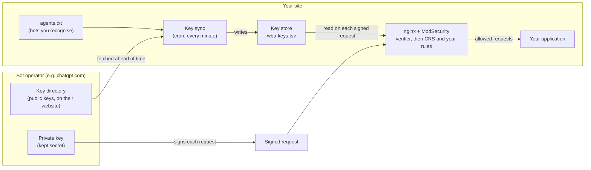
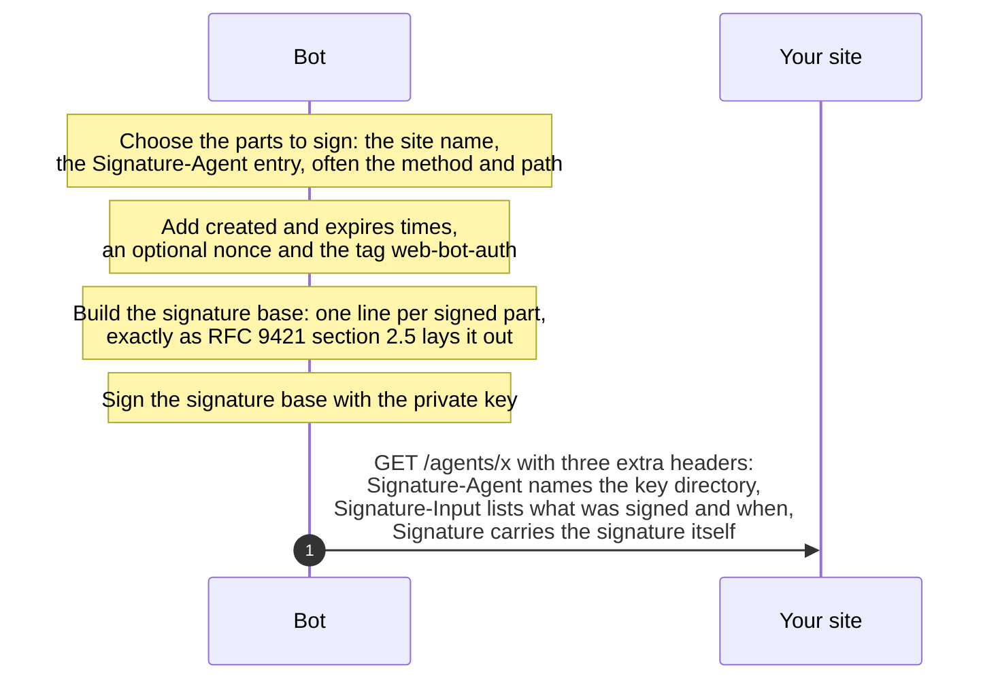
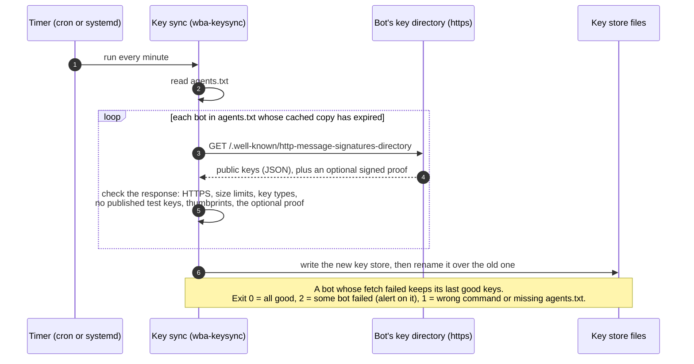
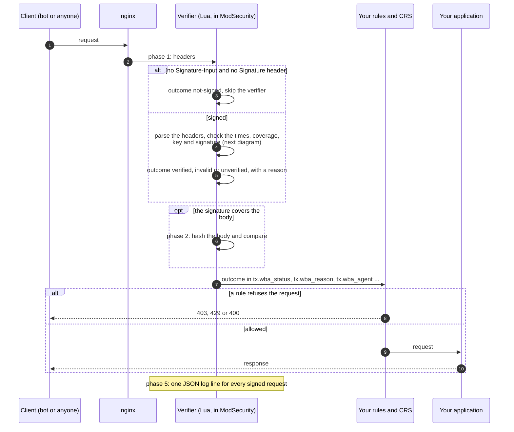
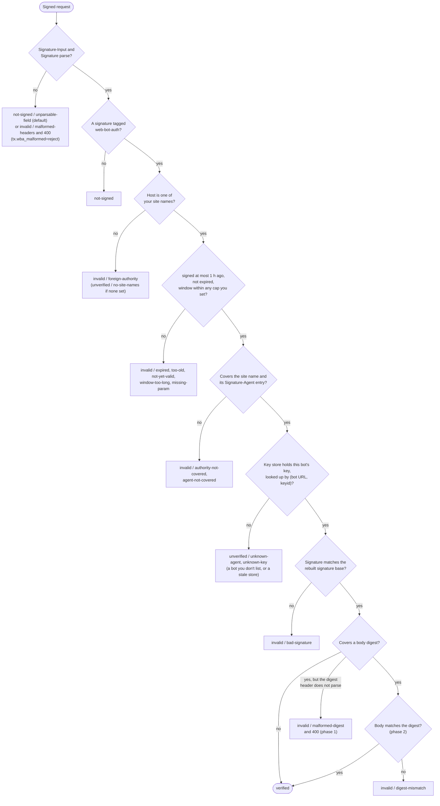
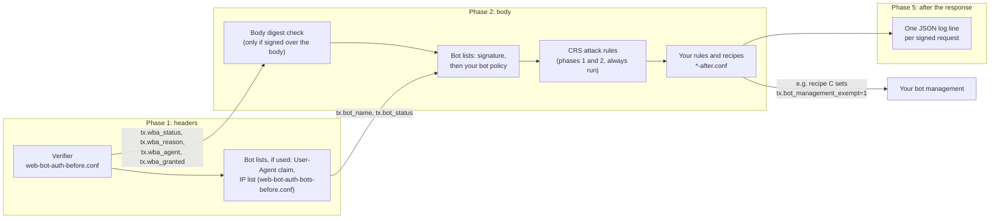
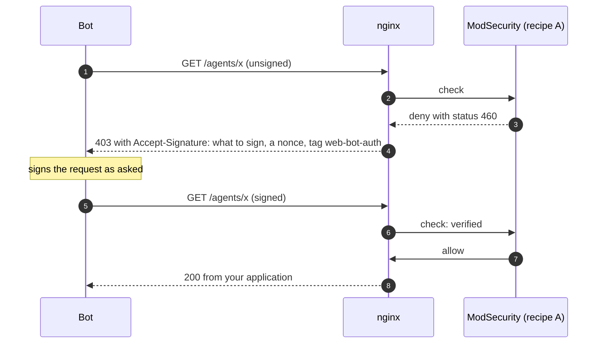
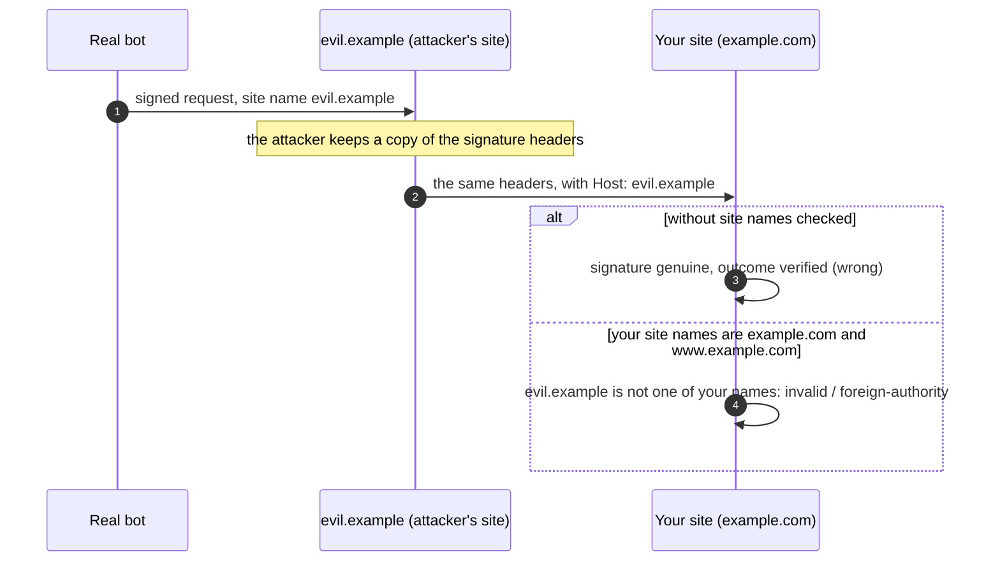

# How Web Bot Auth works here

This page explains, with diagrams, how a bot signs a request, how the bots' keys reach your WAF, what happens when a signed request arrives, and how the result reaches CRS and your own rules. For commands and settings, see the [README](README.md); for the reasons behind each choice, see [DESIGN.md](DESIGN.md).

## Words used on this page

| Word | Meaning here |
|---|---|
| **Bot operator** | The company that runs a bot or AI agent, for example OpenAI for ChatGPT's agent. |
| **Draft -00** | [draft-ietf-webbotauth-httpsig-protocol-00](https://datatracker.ietf.org/doc/draft-ietf-webbotauth-httpsig-protocol/), the Web Bot Auth protocol draft this plugin implements. It builds on [RFC 9421](https://www.rfc-editor.org/rfc/rfc9421), HTTP Message Signatures. |
| **Key pair** | Two linked keys. The bot keeps the **private key** secret and signs with it; anyone can check a signature with the matching **public key**. |
| **Signature** | A short value the bot computes over parts of its request with its private key. Only the private key's holder can produce it, and changing a signed part breaks it. |
| **Key directory** | A file the bot operator publishes on its own website, at `https://<their site>/.well-known/http-message-signatures-directory`, listing its public keys. |
| **`Signature-Agent`** | A request header in which the bot names its key directory. |
| **`agents.txt`** | The list of the bots you recognise, one key source per line. You keep your list in `bots.yaml`, and `agents.ts` writes `agents.txt` from it. Keys from bots not on it are never trusted. |
| **Key sync** | `wba-keysync`, a small program you run on a timer. It fetches the key directories of the bots in `agents.txt` and writes their public keys to the key store. |
| **Key store** | `wba-keys.tsv`, the file of public keys the WAF reads. |
| **Verifier** | This plugin's checking code. It runs inside ModSecurity, in front of your application, and decides whether a request's signature is genuine. |
| **Outcome** | The verifier's verdict, written into ModSecurity variables: `tx.wba_status` (`verified`, `invalid`, `unverified` or `not-signed`) and `tx.wba_reason` (why). |
| **Recipe** | A ready-made rule in [`recipes.conf`](recipes.conf) that acts on the outcome, for example "refuse anything not `verified` on `/agents/`". |
| **CRS** | The OWASP Core Rule Set, the attack-detection rules that run in the same ModSecurity. |

## The big picture

Two things happen at different times. **Ahead of time**, your key sync copies the public keys of the bots you recognise onto your WAF. **On each request**, the verifier checks the signature against those copied keys, gives the request an outcome, and your rules and CRS act on it. The verifier never fetches anything while a request waits.



## 1. How a bot signs a request

The bot chooses which parts of its request to sign. Draft -00 requires at least the site name (`@authority`, from the Host header, or the full `@target-uri`) and, when it sends one, the `Signature-Agent` entry naming its key directory; many bots also sign the method and path.



What the three headers look like (one signature, labelled `sig1`):

```
Signature-Agent: sig1="https://bot.example"
Signature-Input: sig1=("@authority" "signature-agent";key="sig1");created=1790922496;expires=1790922556;keyid="eTnUpXZYhQFajMO2QSWeganNyW1dkGV58okMu-2NJLY";tag="web-bot-auth"
Signature: sig1=:<base64 signature>:
```

The `keyid` is the key's [RFC 7638](https://www.rfc-editor.org/rfc/rfc7638) thumbprint, a hash of the public key, so the verifier can find the right key in the bot's directory. This example signs only the site name and the `Signature-Agent` entry, the least Draft -00 allows. It can be `verified` but is never granted (`tx.wba_granted` stays 0): a signature over the site name alone works for any page, so a grant needs `@method` and `@path` too.

## 2. How the bots' keys reach your WAF

Key sync runs on a timer (cron or systemd, every minute). It only fetches the bots listed in `agents.txt`, only over HTTPS, and only when its cached copy has expired, so most runs make no request at all. It never runs while a request waits.



Because the store is replaced in one rename, the verifier never reads a half-written file. It reads the store on every signed request, so a new key works without restarting the WAF.

## 3. What happens when a request arrives

Every request passes through nginx and ModSecurity. Unsigned requests cost almost nothing: one rule sees there is neither a `Signature-Input` nor a `Signature` header and skips the verifier. Signed requests go through the checks below, in ModSecurity's phase 1 (headers), with a second step in phase 2 (body) only when the signature covers the body.



**What ModSecurity cannot see.** Whether the client used TLS, and a host written in the request line (`GET http://other.example/`): it sees only the `Host` header. So serve signed traffic over HTTPS, because over plain HTTP anyone on the path can change what a signature does not cover. The request-line host matters only when one nginx serves several sites ([DESIGN.md](DESIGN.md#what-modsecurity-cannot-see), and the README's [Known limits](README.md#known-limits)).

**Headers that do not parse.** An unparsable `Signature-Input` or `Signature` is ignored by default, so the request counts as unsigned (`not-signed/unparsable-field`, RFC 9651 section 4.2); with `tx.wba_malformed=reject` it is `invalid/malformed-headers` and rule 9534107 answers **400**. An unparsable `Signature-Agent` is `invalid` under either setting. Usually that is `invalid/missing-component`, with no 400: the signature covers one entry (`"signature-agent";key="sig1"`), which cannot be found in a header that does not parse. Only a signature over the whole header gets `invalid/unparsable-agent`, or with `reject`, `invalid/malformed-headers` and the 400. A covered body digest header that does not parse is always `invalid/malformed-digest` and **400**: ignoring it would leave the body unchecked while the signature says it covers it.

## 4. How the verifier decides

The verifier checks each signature tagged `web-bot-auth` on its own, and the request gets the best result among them.



What the four outcomes mean for your rules:

| Outcome | Means | Typical use |
|---|---|---|
| `verified` | A bot you listed signed this request with a current key, and the signature is genuine. It says who signed, not that the request is harmless: CRS still inspects it. | Grant or exempt (recipes A and C). |
| `invalid` | A check failed. `foreign-authority` (made for another site), `bad-signature`, `digest-mismatch` and `test-key` mean the signature cannot be genuine for this request; the rest are usually a misconfigured bot. | Refuse only the "cannot be genuine" reasons (recipe F). |
| `unverified` | The verifier could not decide: the bot is not in your `agents.txt`, its key is new, or your site names are not set (`no-site-names`). | Treat as unsigned. |
| `not-signed` | No Web Bot Auth signature. | Your normal bot handling. |

The full list of reasons is in the [README](README.md#outcomes-and-reasons).

## 5. How the outcome reaches CRS and your rules

The verifier runs as CRS's **before** plugin, so its outcome exists before any CRS rule runs. Your own rules go in a `*-after.conf` file and run after CRS in the same phase. The plugin itself blocks nothing except broken protocol: rule 9534107's 400 (section 3). The bot-list rules, if you use them, load right after the verifier and before CRS's rules, and set `tx.bot_status` for your rules in the same way.



The recipes, in one line each:

| Recipe | Does |
|---|---|
| A | On paths reserved for bots, refuse anything not `verified` and ask for a signature (403 with `Accept-Signature`). |
| B | If the User-Agent claims to be a given bot, require that bot's signature. |
| C | Mark granted bots so your own bot management can exempt them (never CRS attack detection). |
| D | With replay accounting on, allow a signed statement once on the bot paths. |
| E | With replay accounting on, allow a nonce once anywhere. |
| F | Refuse signatures that cannot be genuine: `foreign-authority`, `bad-signature`, `digest-mismatch`, `test-key`. |

## 6. Asking a bot to sign

When recipe A refuses an unsigned request, nginx answers 403 with an `Accept-Signature` header that tells the bot what to sign, including a fresh nonce. ModSecurity cannot add response headers, so the rule uses the private status 460 and an nginx file turns it into the 403.



The verifier does not check that the nonce returned is the one nginx issued; [DESIGN.md](DESIGN.md#asking-for-a-signature-in-detail) explains why.

## Settings that limit what a signature can do

Each is a setting in [web-bot-auth-config.conf](web-bot-auth-config.conf).

**Your site names** (`tx.wba_site_names`, required). A signature names the site it was made for, from the Host the bot sent. You list your own names once; a signature made for any other name is `invalid/foreign-authority`. Until the list is set, nothing verifies.

The others bound how long a signature counts (`tx.wba_max_age`, an hour; `tx.wba_expiry_grace`), what an unparsable signature header does (`tx.wba_malformed`, section 3), and what a grant needs the signature to cover (`tx.wba_grant_require_components`, `@method @path`). The README's [Controls and defaults](README.md#controls-and-defaults) table lists each with its default.

Bot lists sit beside the signature check: `wba-keysync/lists.ts` writes plain SecRules from each bot operator's published IP ranges and User-Agent tokens, so a request also carries `tx.bot_status` (`claimed` by its User-Agent, or `verified` by the bot's IP list or signature) for your bot policy. The WAF compiles the ranges when it starts, so a request never waits on a fetch or a DNS lookup. Reverse DNS checks, for the few operators that publish only host names, are not built.

How the site names stop a replay:


